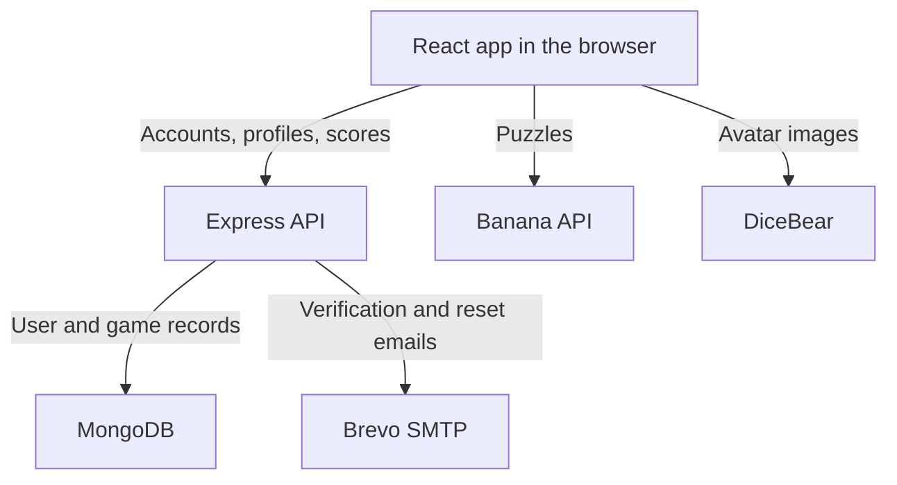

# Math Banana architecture

## How a game works

1. The signed-in player selects a difficulty. [GameBoard](../client/src/components/Game/GameBoard.jsx) loads a puzzle through [the Banana API client](../client/src/components/Game/fetchPuzzle.js).
2. The timer counts down while a puzzle is available. Correct answers add points and load another puzzle. Incorrect answers cost a life. A failed puzzle request pauses play and offers a retry.
3. When time or lives run out, [GameContext](../client/src/context/GameContext.jsx) sends the final score to Express. The [game controller](../server/controllers/game.controller.js) updates the player's game record in a MongoDB transaction. The leaderboard reads high scores from these records.

## Responsibilities

| Component | Responsibility |
| --- | --- |
| [React routes](../client/src/App.jsx) | Map pages and apply [route guards](../client/src/components/Auth/ProtectedRoute.jsx). |
| [AuthContext](../client/src/context/AuthContext.jsx) | Manage the signed-in session and account actions. |
| [GameContext](../client/src/context/GameContext.jsx) | Share game state and handle score, stats, and leaderboard requests. |
| [UserContext](../client/src/context/UserContext.jsx) | Load and update profile data. |
| [Express app](../server/app.js) | Mount API routes and configure request middleware. [Server startup](../server/server.js) connects to MongoDB before listening. |
| [Auth middleware](../server/middleware/userAuth.js) | Verify the JWT cookie and supply the user ID to protected handlers. |

## Game API

These endpoints expect the signed-in session cookie. Successful responses use the shape `{ success: true, data: ... }`. Clients should check the response's `success` field.

| Method and path | Request | Successful result |
| --- | --- | --- |
| `POST /api/game/scores` | JSON body with `score` and optional ISO date `playedDate` | Updated high score, daily streak, last played date, last game score, and wins. |
| `GET /api/game/stats` | Session cookie | High score, daily streak, last played date, games played, and wins. |
| `GET /api/game/leaderboard` | Session cookie | Up to 10 records with positive high scores, sorted highest first. Each entry includes the player's username and avatar. |

The [route definitions](../server/routes/game.route.js) show middleware and rate limiting. See the [event examples](EVENTS.md) for coursework evidence and the [README](../README.md) for local setup.
